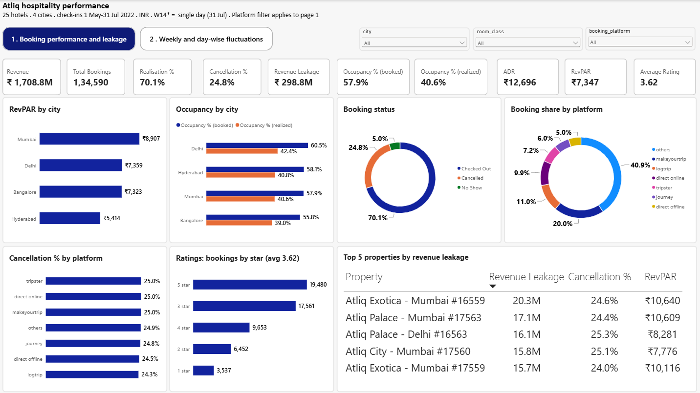

# 🏨 Hospitality Analytics – AtliQ Hotels

## 📌 Project Overview

This project focuses on analyzing hotel booking data to understand business performance and identify opportunities for improvement.

## 🎯 Project Objectives

- Analyze hotel revenue performance.
- Understand occupancy trends.
- Evaluate booking realization and cancellation rates.
- Identify revenue leakage.
- Compare hotel performance across cities and properties.

## 📸 Dashboard Preview

### 1. Booking Performance and Revenue Leakage

### 2. Weekly and Day-wise Fluctuations

## 🛠️ Tools Used

- Microsoft Excel
- Power BI
- DAX
- Data Modeling

## 📊 Key Performance Indicators (KPIs)

- Revenue
- Occupancy %
- ADR (Average Daily Rate)
- RevPAR (Revenue Per Available Room)
- Booking Realization %
- Revenue Leakage
- Cancellation %

## 📁 Project Files

- `Atliq Hotels Hospitality Analysis.xlsx` – Excel analysis.
- `Atliq Hotels Hospitality Analysis.pbix` – Power BI dashboard.
- `Atliq Hotels Hospitality Analysis.pptx` – Project presentation.

## 💡 Key Learning Outcomes

- Data cleaning and preparation.
- Data modeling and relationships.
- KPI calculations and business analysis.
- Dashboard development and visualization.

## 👨‍💻 Author

Soma Sekhar T

Aspiring Data Analyst | Excel | SQL | Power BI | Tableau | Python
